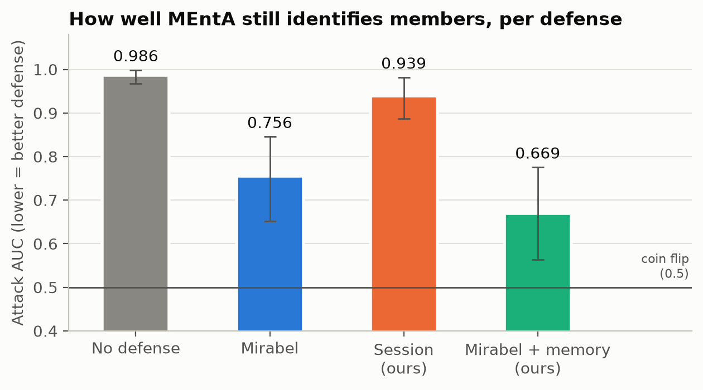
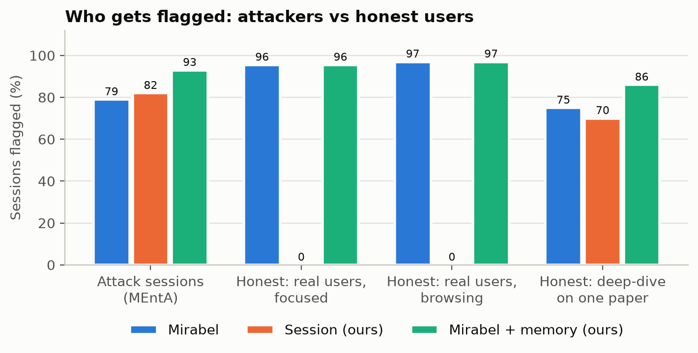
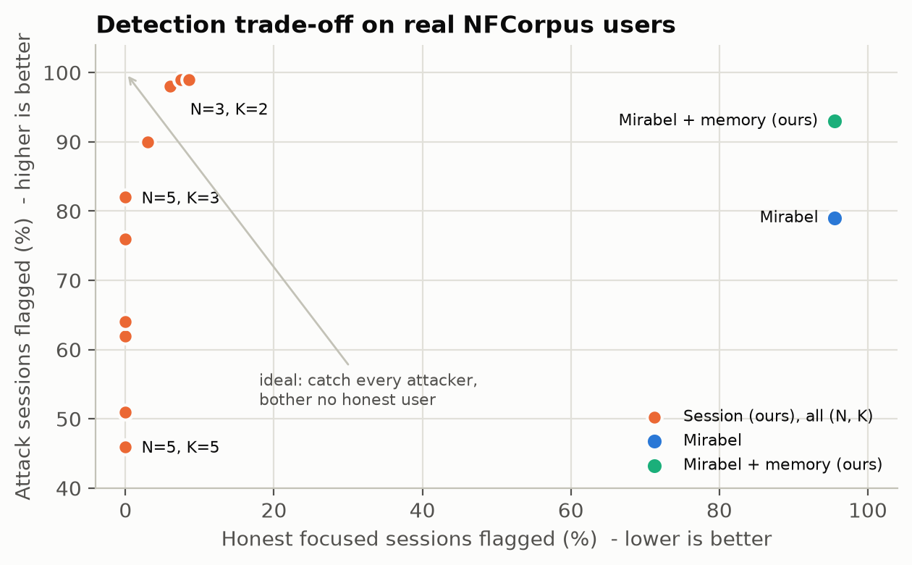

# Session-Level Defense Against Membership Inference on RAG Systems

Reproduction of **MEntA** (Nguyen et al., USENIX Security 2026) and a new
**session-level extension of the Mirabel defense**.
CS 528 Data Security and Privacy · Illinois Institute of Technology · Fall 2026.

## In plain terms

A RAG assistant answers questions from a private document collection. MEntA shows
that an attacker holding a copy of a document can find out whether it is in that
collection by asking just **5 normal-looking questions** and checking whether the
answers contain facts from the document.

The strongest existing defense, Mirabel, judges each question on its own. It catches
the attack, but on corpora like NFCorpus and SCIDOCS it also flags **60–88% of honest
queries**, because honest users ask focused questions too.

This project tests a different signal: **repetition within a session**. An honest
user may ask one sharp question, but an attacker's questions keep landing on the
**same document**. The defense watches a rolling window of recent queries and hides a
document from the context once it is the top match too many times.

## Threat model

- **Target:** black-box RAG. The attacker sends text and reads text only.
- **Goal:** decide whether a candidate document is in the private store.
- **Attacker has:** a copy of the document, a few known non-members for calibration,
  and a small query budget.
- **Defender has:** retrieval results and similarity scores for every query, grouped
  by session.

## Experiment

Three conditions, each evaluated on attack sessions and honest sessions:

| Condition | Description |
|---|---|
| A. No defense | Reproduces MEntA's attack |
| B. Mirabel | Per-query similarity-outlier detection + hide |
| C. Session-level (ours) | Flag when one doc is top-1 in ≥K of the last N queries + hide |
| D. Mirabel + memory (ours) | Mirabel's flags stay hidden for the whole session, plus the C rule |

**Metrics:** attack AUC and TPR@1%FPR · share of attack sessions flagged ·
share of honest sessions flagged (false-positive rate) · honest-query utility.

## Repository layout

```
ragmia/       library code (config, data, RAG system; attack and defenses to come)
scripts/      numbered pipeline steps, run in order
docs/         design decisions, report, slides
data/         generated locally by scripts/01 (not committed)
```

## Setup

Requires macOS or Linux, Python 3.12, and [Ollama](https://ollama.com).

```bash
git clone https://github.com/BhavishyaMangalasary/rag-session-mia-defense.git
cd rag-session-mia-defense
python3.12 -m venv .venv
source .venv/bin/activate
pip install -e .
ollama pull qwen2.5:7b
```

**macOS note:** if `import ragmia` fails with `ModuleNotFoundError` after installing,
macOS may have marked the environment's files as hidden (common for folders synced to
iCloud, such as Documents). Fix with `chflags -R nohidden .venv`, or keep the project
outside iCloud-synced folders.

## Running

| Step | Command | Status |
|---|---|---|
| 1. Prepare data and index | `python scripts/01_prepare_data.py` | ✅ |
| 1. Smoke-test the RAG | `python scripts/02_smoke_test.py --generate` | ✅ |
| 2. Generate attacker queries | `python scripts/03_generate_attack_queries.py` | ✅ |
| 2. MEntA attack (condition A) | `python scripts/04_run_attack.py` | ✅ |
| 3. Mirabel detection rates | `python scripts/05_mirabel_detection.py` | ✅ |
| 3. MEntA vs Mirabel (condition B) | `python scripts/04_run_attack.py --defense mirabel` | ✅ |
| 4. Unit tests (also run by GitHub Actions) | `pytest -v` | ✅ |
| 4. MEntA vs session defense (condition C) | `python scripts/04_run_attack.py --defense session` | ✅ |
| 4. MEntA vs Mirabel + memory (condition D) | `python scripts/04_run_attack.py --defense mirabel_session` | ✅ |
| 4. Query-budget analysis | `python scripts/06_query_budget.py none mirabel session` | ✅ |
| 5. Honest sessions + session-rule sweep | `python scripts/07_honest_sessions.py` | ✅ |
| 5. Simulated deep-dive and reader sessions | `python scripts/08_simulated_sessions.py` | ✅ |
| 5. Adaptive attacker (decoys, no prefix) | `python scripts/09_adaptive_attacker.py` | ✅ |
| 6. Figures and summary table | `python scripts/10_make_figures.py` | ✅ |

Design choices and deviations from the paper are logged in
[`docs/decisions.md`](docs/decisions.md).

## Key findings

1. **Reproduction:** MEntA identifies members with AUC **0.986** using 5 natural queries
   (paper: 0.935 for the same retriever, generator and dataset).
2. **One answer is almost enough:** a single answer already gives the attacker AUC **0.924**,
   so any defense that waits to observe a pattern cannot push the attack much below that.
3. **Mirabel is noisy:** it flags **50.6%** of single honest queries and **~96%** of honest
   sessions, while lowering the attacker's AUC only to 0.756.
4. **Session rule (ours):** catches **82%** of attack sessions (98% at K=2) while flagging
   **0%** of 400 real honest NFCorpus sessions: a near-free detector for everyday traffic.
5. **Mirabel + memory (ours):** the strongest protection (AUC **0.669**, 93% of attacks flagged),
   and robust to decoys, at Mirabel's cost to honest users.
6. **Limits:** decoys (2 per question) evade the session rule; honest users who focus on one
   specific paper are indistinguishable from attackers for every retrieval-based defense.





More figures: [query budget](results/nfcorpus/figures/fig3_query_budget.png) ·
[adaptive attacker](results/nfcorpus/figures/fig4_adaptive_attacker.png) ·
full numbers in [`docs/decisions.md`](docs/decisions.md).

## Results

| Condition | Attack AUC | TPR@1%FPR | Attack sessions flagged | Honest sessions flagged |
|---|---|---|---|---|
| A. No defense | 0.986 (95% CI 0.967–0.999) | 0.66 | n/a | n/a |
| B. Mirabel | 0.756 (95% CI 0.652–0.846) | 0.22 | 79.0% | 95.5% focused / 97.0% browsing |
| C. Session-level (N=5, K=3) | 0.939 (95% CI 0.887–0.982) | 0.18 | 82.0% | **0% / 0%** |
| D. Mirabel + memory | **0.669** (95% CI 0.563–0.775) | **0.14** | **93.0%** | 95.5% / 97.0% |

## Limitations

- Small sample (50 + 50 documents), so results are noisier than in the paper.
- Answers returned before a session is flagged still reach the attacker.
- An attacker who spreads queries across sessions or identities is not seen by a
  per-session monitor; this is evaluated with an adaptive attacker.

## Ethics

Only public benchmark data (BEIR) is used. No deployed system is attacked. The
attack is already published; this work focuses on the defense.

## References

1. Nguyen et al. *Five Queries Are Enough: Query-Efficient and Surrogate-Free
   Membership Inference Attacks on RAG via Entailment.* USENIX Security 2026.
   Artifact: https://doi.org/10.5281/zenodo.20335970
2. Choi et al. *Safeguarding Privacy of Retrieval Data against Membership Inference
   Attacks: Is This Query Too Close to Home?* Findings of EMNLP 2025.
3. Naseh et al. *Riddle Me This! Stealthy Membership Inference for
   Retrieval-Augmented Generation.* ACM CCS 2025.
4. Thakur et al. *BEIR: A Heterogeneous Benchmark for Zero-shot Evaluation of
   Information Retrieval Models.* NeurIPS Datasets & Benchmarks 2021.