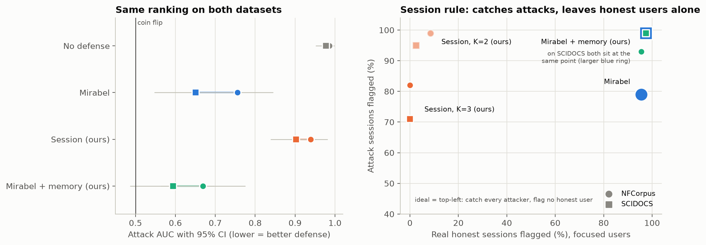

# Session-Level Defense Against Membership Inference on RAG Systems

Reproduction of **MEntA** (Nguyen et al., USENIX Security 2026) and an evaluation of
**session-level defenses** against it, on two datasets (NFCorpus and SCIDOCS).
CS 528 Data Security and Privacy · Illinois Institute of Technology · Fall 2026.

[](https://github.com/BhavishyaMangalasary/rag-session-mia-defense/actions/workflows/tests.yml)

## In plain terms

A RAG assistant answers questions from a private document collection. MEntA shows
that an attacker holding a copy of a document can find out whether it is in that
collection by asking just **5 normal-looking questions** and checking whether the
answers contain facts from the document.

The strongest existing defense, Mirabel (Choi et al., EMNLP Findings 2025), judges each
question on its own. It weakens the attack, but it also flags **most honest users**,
because honest users ask specific questions too.

MEntA's authors suggested session-level monitoring as future work (Appendix D). This project
builds and evaluates it: a defense that notices when the **same document** keeps being the top
match across a user's recent questions, plus a combined version that gives Mirabel a memory.

## Key findings (both datasets)

1. **Reproduction:** MEntA reaches AUC **0.986** on NFCorpus and **0.978** on SCIDOCS with 5 queries
   (paper: 0.935 and 0.936 for the same retriever and generator).
2. **One answer is almost enough:** a single answer already gives AUC **0.924 / 0.892**, so any
   defense that waits to see a pattern cannot push the attacker much below that.
3. **Mirabel is noisy:** it flags **51% / 81%** of single honest queries and **96–100%** of honest
   sessions.
4. **Session rule (ours):** flags **0%** of real honest sessions on both datasets while catching
   **82% / 71%** of attack sessions (**99% / 95%** at K=2, with 8.5% / 2.5% of focused honest users).
5. **Mirabel + memory (ours):** the strongest protection, attack AUC **0.669 / 0.594** (the SCIDOCS CI
   includes 0.5), robust to decoy questions, but it flags honest users as often as Mirabel.
6. **Limits:** 2 decoys per question evade the session rule; users who focus on one specific paper
   are indistinguishable from attackers for every retrieval-based defense.



Per-dataset figures: [NFCorpus](results/nfcorpus/figures/) · [SCIDOCS](results/scidocs/figures/) ·
full numbers and design choices in [`docs/decisions.md`](docs/decisions.md).

## Threat model

- **Target:** black-box RAG. The attacker sends text and reads text only.
- **Goal:** decide whether a candidate document is in the private store.
- **Attacker has:** a copy of the document, a few known non-members for calibration,
  and a small query budget.
- **Defender has:** retrieval results and similarity scores for every query, grouped by session.

## Experiment

| Condition | Description |
|---|---|
| A. No defense | Reproduces MEntA's attack |
| B. Mirabel | Per-query similarity-outlier detection + hide |
| C. Session-level (ours) | Hide a document once it is top-1 in ≥K of the last N queries (default N=5, K=3) |
| D. Mirabel + memory (ours) | Mirabel's flags stay hidden for the whole session, plus the C rule |

Evaluated on attack sessions, real honest sessions (focused and browsing), simulated deep-dive
sessions, and an adaptive attacker that inserts decoy questions.

## Setup

Requires macOS or Linux, Python 3.12, and [Ollama](https://ollama.com).

```bash
git clone https://github.com/BhavishyaMangalasary/rag-session-mia-defense.git
cd rag-session-mia-defense
python3.12 -m venv .venv
source .venv/bin/activate
pip install -e .
ollama pull llama3.1:8b
ollama pull qwen2.5:7b
```

**Choosing a dataset:** every script runs on NFCorpus by default. For SCIDOCS, put
`RAGMIA_DATASET=scidocs` in front of the command, e.g.
`RAGMIA_DATASET=scidocs python scripts/01_prepare_data.py`. Each dataset keeps its own
`data/<dataset>/` and `results/<dataset>/` folders.

**macOS note:** if `import ragmia` fails with `ModuleNotFoundError` after installing,
macOS may have marked the environment's files as hidden (common for folders synced to
iCloud, such as Documents). Keep the project outside iCloud-synced folders.

## Running

Run in order, once per dataset (times on an Apple Silicon laptop, NFCorpus / SCIDOCS):

| Step | Command | Time |
|---|---|---|
| 1. Prepare data and index | `python scripts/01_prepare_data.py` | ~3 / ~12 min |
| 1. Smoke-test the RAG | `python scripts/02_smoke_test.py --generate` | ~1 min |
| 2. Generate attacker queries | `python scripts/03_generate_attack_queries.py` | ~20 min |
| 2–4. Attack under each defense | `python scripts/04_run_attack.py --defense none` (then `mirabel`, `session`, `mirabel_session`) | ~40–50 min each |
| 3. Mirabel detection rates | `python scripts/05_mirabel_detection.py` | ~1 min |
| 4. Query-budget analysis | `python scripts/06_query_budget.py none mirabel session` | ~6 min |
| 5. Honest sessions + (N, K) sweep | `python scripts/07_honest_sessions.py` | ~2 min |
| 5. Simulated deep-dive and reader sessions | `python scripts/08_simulated_sessions.py` | ~15 min |
| 5. Adaptive attacker | `python scripts/09_adaptive_attacker.py` | ~1 min |
| 6. Figures (per dataset) | `python scripts/10_make_figures.py` | seconds |
| 6. Cross-dataset figure (once both are done) | `python scripts/11_compare_datasets.py` | seconds |
| Unit tests (also run by GitHub Actions) | `pytest -v` | seconds |

## Results

| Condition | Attack AUC (NFCorpus / SCIDOCS) | TPR@1%FPR | Attack sessions flagged | Real honest sessions flagged (focused / browsing) |
|---|---|---|---|---|
| A. No defense | 0.986 / 0.978 | 0.66 / 0.58 | — | — |
| B. Mirabel | 0.756 / 0.651 | 0.22 / 0.10 | 79% / 99% | 95.5–97% / 97.5–100% |
| C. Session-level (N=5, K=3) | 0.939 / 0.903 | 0.18 / 0.18 | 82% / 71% | **0% / 0%** on both |
| D. Mirabel + memory | **0.669 / 0.594** | **0.14 / 0.04** | **93% / 99%** | 95.5–97% / 97.5–100% |

## Repository layout

```
ragmia/       library code (config, data, RAG system, attack, defenses, sessions, metrics)
scripts/      numbered pipeline steps, run in order
tests/        unit tests for the defenses (run by GitHub Actions)
docs/         design decisions log
results/      per-dataset results and figures, plus the cross-dataset comparison
data/         generated locally (not committed)
```

## Limitations

- 50 + 50 target documents per dataset (paper: 1,000 + 1,000); results carry 95% CIs.
- Two datasets, one retriever (all-mpnet-base-v2) and one generator (Llama 3.1 8B).
- Harder honest users are simulated by an LLM; per-session defenses assume queries can be
  linked to a user, so attackers using many accounts are out of scope.

## Ethics

Only public benchmark data (BEIR) is used, on a RAG system run locally. No deployed system is
attacked. The attack is already published; this work focuses on the defense.

## References

1. Nguyen et al. *Five Queries Are Enough: Query-Efficient and Surrogate-Free Membership
   Inference Attacks on RAG via Entailment.* USENIX Security 2026.
   Artifact: https://doi.org/10.5281/zenodo.20335970
2. Choi et al. *Safeguarding Privacy of Retrieval Data against Membership Inference Attacks:
   Is This Query Too Close to Home?* Findings of EMNLP 2025.
3. Naseh et al. *Riddle Me This! Stealthy Membership Inference for Retrieval-Augmented
   Generation.* ACM CCS 2025.
4. Thakur et al. *BEIR: A Heterogeneous Benchmark for Zero-shot Evaluation of Information
   Retrieval Models.* NeurIPS Datasets & Benchmarks 2021.